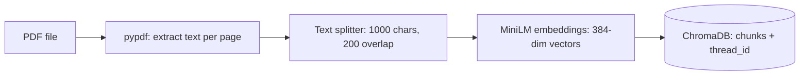
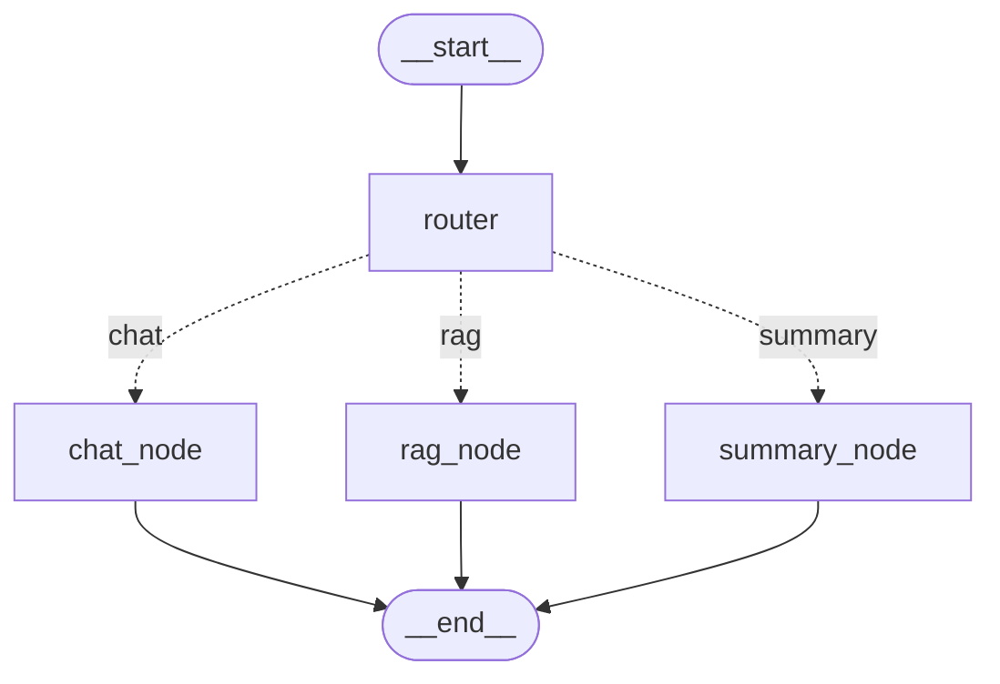
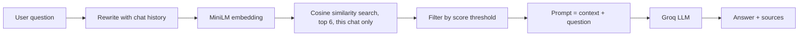

# 🪐 Samvad: Chat with an AI that can also read your PDFs

Samvad is a chatbot that works in two modes. It talks like a normal AI assistant, and when you upload a PDF it **answers from your document** and shows you exactly where the answer came from.

**Live demo:** https://chatbot247.streamlit.app

---

## What did we build?

A ChatGPT-style web app with:

- A normal chat that remembers your conversations
- A **PDF upload** option in the sidebar
- Answers that come **only from your document**, with page numbers and source snippets
- An automatic "brain" (a router) that decides whether your message is small talk, a question about the document, or a request to summarize it

## What problem does it solve?

| Problem | How Samvad solves it |
|---|---|
| Reading a 100-page PDF to find one answer takes forever | Ask a question in plain language and get the answer in seconds |
| Normal chatbots don't know your private documents | Your PDF is indexed so the AI can read it |
| AI chatbots sometimes make things up (hallucination) | The AI is told to answer **only from the document** and says "I don't know" if the answer is missing |
| You can't trust an answer without proof | Every answer comes with **sources** (file, page, snippet) |
| Plain RAG apps fail on "hello" or "summarize this" | A **router** sends each message to the right handler |

## Features

-  **Multi-chat history** with a sidebar (each chat has its own memory)
-  **Chat-wise documents**: a PDF uploaded in one chat stays in that chat
-  **Smart router**: decides between normal chat, document Q&A, and summary
-  **Follow-up understanding**: "in big data" is rewritten into a full question using the chat history
-  **Sources shown** with every document answer
-  **Document summary** that samples the whole PDF, not just a few chunks
-  **Streaming replies**, token by token

---

## Tech stack

| Part | Tool | Why we use it |
|---|---|---|
| Agent framework | **LangGraph** | Builds the chatbot as a graph of steps (router, nodes) |
| LLM | **Groq** (`openai/gpt-oss-120b`) | Very fast answers |
| Embeddings | **sentence-transformers** (`all-MiniLM-L6-v2`) | Turns text into 384-number vectors that capture meaning |
| Vector database | **ChromaDB** | Stores chunks and finds the most similar ones |
| PDF reading | **pypdf** | Extracts text page by page |
| Text splitting | **langchain-text-splitters** | Cuts pages into overlapping chunks |
| Chat memory | **SQLite** (`SqliteSaver`) | Saves every conversation |
| Frontend | **Streamlit** | The web interface |
| Config | **python-dotenv** | Keeps the API key out of the code |

---

## Architecture

The system has three parts: **ingestion** (adding a document), the **LangGraph flow** (deciding what to do), and the **query** path (answering from the document).

### 1. Ingestion: when you upload a PDF



### 2. LangGraph flow: every message goes through the router



### 3. Query: what happens inside `rag_node`



---

## Step by step

### Ingestion (`add_pdf`)

1. The PDF is read in memory and text is extracted **page by page**.
2. Each page is split into overlapping chunks of about **1000 characters** (200 overlap so sentences are not cut in a way that loses meaning).
3. Each chunk is converted into a **384-number vector** (an embedding) that represents its meaning.
4. Chunks, vectors and metadata (`thread_id`, file name, page number) are saved in **ChromaDB**.
5. Uploading the same PDF again does not create duplicates (`upsert`).

### Routing (`router_node`)

Before answering, a small LLM call classifies the message:

| Message type | Example | Goes to |
|---|---|---|
| Small talk or general question | "hello", "what is Python?" | `chat_node` |
| Specific question about the document | "what is a data stream?" | `rag_node` |
| Whole-document request | "summarize the document", "important topics" | `summary_node` |

If no document is uploaded in the chat, everything goes to `chat_node`.

### Answering from the document (`rag_node`)

1. **Rewrite**: a follow-up like "in big data" becomes a standalone question using recent chat history.
2. **Embed**: the question is converted into a vector with the same model used for the chunks.
3. **Search**: ChromaDB finds the 6 most similar chunks using cosine similarity, **only from the current chat's documents**.
4. **Filter**: chunks with a similarity score below 0.30 are dropped. If nothing is left, it retries without the threshold so a good chunk is not lost because of wording differences.
5. **Generate**: the LLM gets the chunks as context with a strict instruction: *answer only from this context, otherwise say you don't know*.
6. **Show sources**: file name, page number, score and a text snippet appear under the answer.

### Summaries (`summary_node`)

Similarity search cannot answer "what are the main topics?" because that question does not match any single chunk. So this node takes **12 evenly spaced chunks across the whole document** (start, middle and end) and asks the LLM to build a structured summary.

---

## Project structure

```
LangGraph-Chatbot/
├── langgraph_backend.py    # RAG ingestion, router, nodes, LangGraph graph
├── streamlit_frontend.py   # Chat UI, sidebar, PDF upload, sources
├── requirements.txt        # Dependencies
├── .streamlit/
│   └── config.toml         # Dark theme
└── .env                    # GROQ_API_KEY (not committed)
```

## Getting started

### 1. Clone and install

```bash
git clone https://github.com/Vivek-ML001/LangGraph-Chatbot.git
cd LangGraph-Chatbot
python -m venv myenv
myenv\Scripts\activate        # Windows
# source myenv/bin/activate   # Mac / Linux
pip install -r requirements.txt
```

### 2. Add your API key

Create a `.env` file in the project root:

```
GROQ_API_KEY=your_groq_api_key_here
```

Get a free key at https://console.groq.com.

### 3. Run

```bash
streamlit run streamlit_frontend.py
```

### 4. Use it

1. Type "hello" to chat normally.
2. Upload a PDF in the sidebar and click **Add to knowledge base**.
3. Ask questions like "what is a data stream?" or "summarize the document".
4. Open **Sources** under an answer to check where it came from.

### Deploying on Streamlit Cloud

- Push the repo to GitHub and make sure `requirements.txt` includes every dependency.
- Add `GROQ_API_KEY` in **App settings → Secrets**:
  ```toml
  GROQ_API_KEY = "your_groq_api_key_here"
  ```

---

## Design decisions

- **Thread-wise documents:** every chunk stores a `thread_id`, so a document belongs to one chat only.
- **Helper LLM with a `nostream` tag:** router and rewrite calls run silently, so only the real answer streams into the UI.
- **Strict grounding prompt:** reduces hallucination by forbidding outside knowledge in document answers.
- **Threshold fallback:** avoids false "not found" answers caused by wording mismatch.
- **Router fails safe:** if the router call fails, the message goes to document mode instead of crashing.

## Limitations

- Chats and documents are stored in the system's temp folder, so they can be **cleared when the cloud app restarts**.
- Only text-based PDFs work. Scanned PDFs (images) need OCR.
- Search is purely semantic. Exact keyword matches can be missed.

## Future improvements

- Hybrid search (BM25 + embeddings) and a reranker
- Evaluation with a Q&A test set or RAGAS
- Persistent storage (hosted vector DB) so documents survive restarts
- Support for DOCX, TXT and web pages
- Human-in-the-loop and tool use (web search) as extra graph nodes

---

## Author

**Vivek Kumar**
B.Tech CSE (Machine Learning), Gautam Buddha University

[LinkedIn](https://www.linkedin.com/in/vivek-kumar-9895a8254/) · [GitHub](https://github.com/Vivek-ML001)
